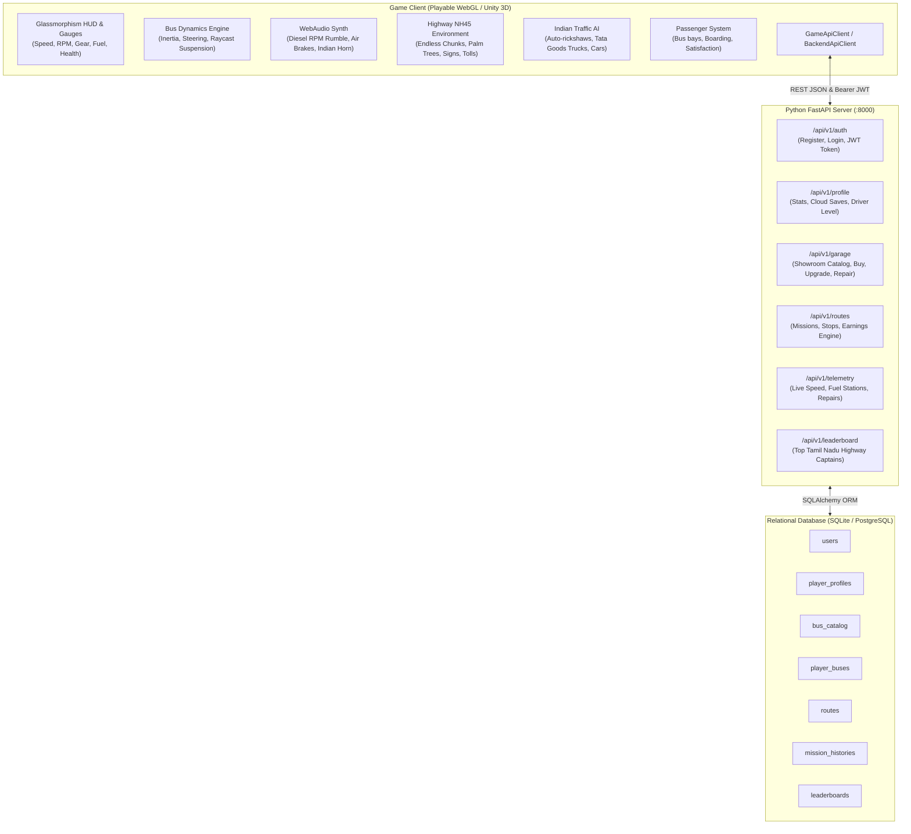

# Tamil Nadu 3D Bus Simulator - Architecture & System Design

This document details the architectural blueprint of the **Tamil Nadu 3D Bus Driving Simulator**, including client-server interactions, data flow, physics modeling, and database schemas.

---

## 🏗️ System Overview

The project is structured into three primary components:
1. **Frontend Game Client**:
   * **Playable 3D WebGL Simulator**: Built with Three.js with realistic procedural Indian bus model, physics engine, Web Audio diesel synthesizer, dynamic day/night weather, AI traffic, and glassmorphism HUD.
   * **Unity 3D Engine Architecture**: Full C# component scripts (`BusController`, `WheelCollider` setup, `DayNightCycle`, `TrafficCarAI`, `BackendApiClient`).
2. **Backend API Service**:
   * Built with **Python 3.10+ / FastAPI**.
   * Provides JWT token authentication, player profiles, cloud game saves, vehicle showroom, route missions, live telemetry, and global leaderboards.
3. **Database Layer**:
   * Powered by **SQLAlchemy ORM** targeting **SQLite** (default for portable local runs) or **PostgreSQL** in production.

---

## 🔄 Architecture & Data Flow Diagram

---

## 🚌 Vehicle Physics Modeling

The bus simulation models the physics of a **12-meter commercial Indian bus** (approx. 14,500 kg loaded mass):
* **Steering Geometry**: Bicycle kinematics model with speed-sensitive angular damping. At high speeds, the maximum steer angle progressively limits to prevent rollover, while retaining sharp responsiveness at low depot speeds.
* **Suspension & Body Roll**: Centrifugal lateral G-forces compute chassis tilt (roll around longitudinal axis). Heavy braking dips the front nose (pitch dive).
* **6-Speed Transmission**: Automatic and manual shifting logic with realistic gear ratios matching Ashok Leyland / BharatBenz 6-speed commercial gearboxes.
* **Pneumatic Braking**: Progressive deceleration with signature air brake release hiss sounds.

---

## 👥 Passenger Pickup & Satisfaction Scoring

1. **Bus Bay Detection**: As the bus approaches highway stops (e.g., Chengalpattu, Tindivanam, Villupuram), the distance to the bus bay is calculated.
2. **Boarding Trigger**: When speed drops below 3 km/h and the driver triggers pneumatic doors via `[E]`, passenger NPCs walk towards the bus door.
3. **Fare & Satisfaction Engine**:
   $$\text{Gross Fare} = \text{Passengers Boarded} \times ₹150$$
   $$\text{Net Earnings} = (\text{Base Route Pay} + \text{Gross Fare}) \times \text{Satisfaction Ratio} - \text{Violations Penalties}$$
4. **Safety Deductions**: Speeding through red lights or collisions with AI vehicles inflict damage and deduct points from the driver's safety rating.
